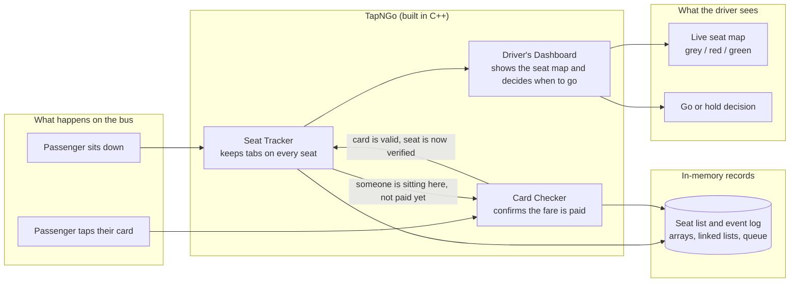
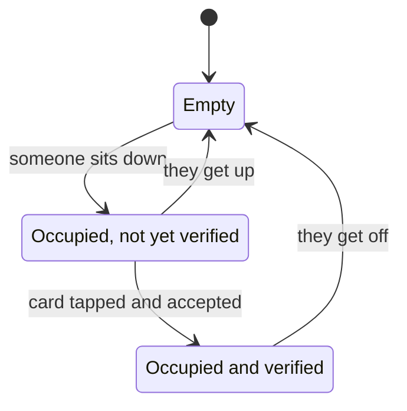
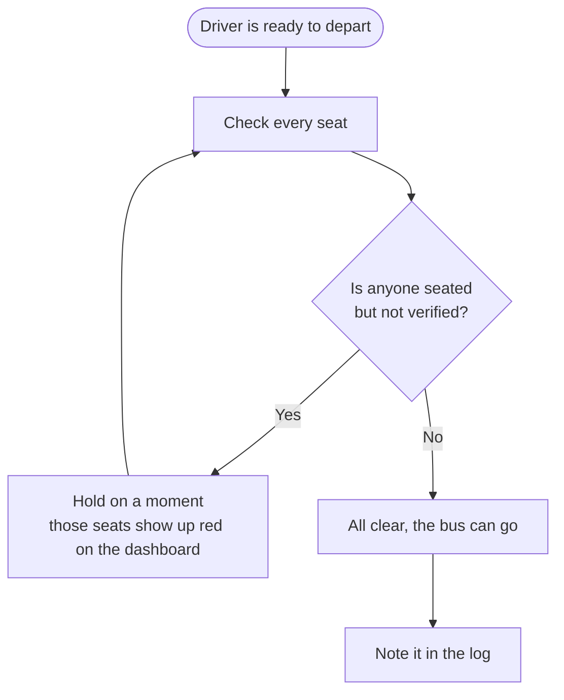

# TapNGo: How It Works

Ever seen a bus crawl to a stop because everyone is queued up at the door while the conductor checks fares? TapNGo is our fix for that.

Instead of checking everyone at the entrance, we check at the **seat**. You sit down, tap your card, and you're verified. The driver gets a live view of which seats are paid up, and the bus only leaves when everyone on board is sorted. No manual headcount, no bottleneck at the door.

Everything runs in C++ using plain data structures (arrays, linked lists and queues) and OOP, with no database involved.

---

## The Big Picture

Here is how a passenger's journey flows through the system.

---

## Life of a Seat

Every seat on the bus is always in one of three moods.

---

## Can We Leave Yet?

Before the bus moves, it quickly asks itself one question: is anyone sitting here without having paid?

---

## Who Does What

| Team member | Role | Task completed | Part of the system |
|---|---|---|---|
| Karnika Jain | Lead | Seat management classes, seat state logic, and OOP architecture | Seat Tracker |
| Anirudh Bahuguna | Developer | Card Verifier, and connecting fare verification to seat state updates | Card Checker |
| Aaditya Budakoti | Data and Testing | Data management, seat state validation, and test cases | Seat Tracker and testing |
| Aparajita Pant | Developer and Docs | Departure readiness logic, driver status panel, and module integration | Driver's Dashboard |

---

## What We Built It With

C++ (with the STL), Visual Studio Code, and Git/GitHub to keep the four of us in sync.
